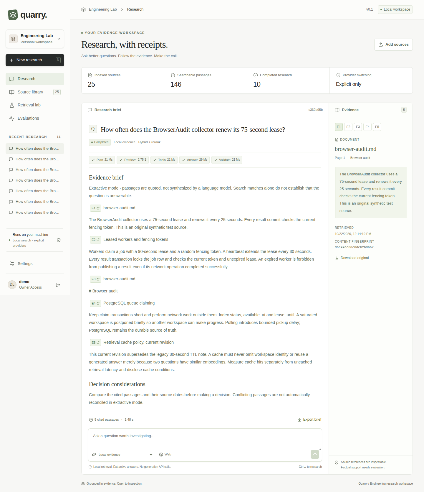

# Quarry

Engineering research with inspectable evidence, reproducible retrieval comparisons, and recoverable background execution.



Upload technical documents, ask a research question, inspect the execution timeline and cited passages, then export a decision brief. The retrieval lab compares dense, BM25, reciprocal-rank fusion and local cross-encoder reranking against the same sources. No generation key is required for document processing, retrieval, calculations or clearly labeled extractive briefs.

**Local release checks passed:** 152 backend tests, eight browser workflows, and 91.4% aggregate critical branch coverage. All eight runtime image families reported zero High/Critical findings in the configured scan. Optional evaluator dependencies have documented local mitigations with raw advisory findings retained. Live answer-quality judging remains partial; public production deployment is not claimed. See [measured results](docs/RESULTS.md) and [audit](docs/AUDIT.md).

## Run

Requires Python 3.11+ for the standard-library management script, Docker Desktop with Linux containers and Compose v2.24.4+ (`!override` in the restore configuration), and GitHub CLI only for publication. Application code and integration tests run in containers. Plan for roughly 50 GB of free disk for source builds, images, models and caches, and about 7 GiB of Docker memory. This laptop's Docker VM has about 7.2 GiB available; actual usage depends on cached and historical builds. Initial image/model downloads need an internet connection.

```powershell
python scripts/manage.py up
```

Open [Quarry](http://localhost:3000). Select **Explore sample workspace**, or create an account and open its verification link in the local [Mailpit inbox](http://localhost:8025). Mailpit captures development mail on this computer; it does not deliver to real email addresses. All sample engineering notes are original synthetic material. Scanned PDFs are rejected with an explicit OCR limitation.

```powershell
python scripts/manage.py verify
python scripts/manage.py benchmark
python scripts/manage.py loadtest
python scripts/manage.py restore-test
```

`verify` builds isolated test containers, checks migrations, lint and contract drift, executes real PostgreSQL/Qdrant/S3 integration tests and Playwright workflows, and enforces aggregate critical branch coverage of at least 90%. `benchmark` executes the frozen 120-case retrieval comparison and a separate 120-run extractive agent measurement. `loadtest` temporarily scales to two APIs and one/two/four workers, then restores one of each. `restore-test` makes an ignored private backup and restores into a separate project at port 3001. These commands can use substantial local CPU/RAM; run measurements separately for clean conditions.

Run free security tools separately:

```powershell
python scripts/security_scan.py --dynamic --images
```

Security checks use public Semgrep rules, Trivy databases, pip-audit and an unauthenticated OWASP ZAP baseline. No hosted scanner account is required. Their reports have different scopes; zero reported findings never proves absence of vulnerabilities.

## Free generation and explicit provider choice

```powershell
python scripts/manage.py configure-groq
python scripts/manage.py benchmark --live
```

Configure your own **Groq Free Plan organization** locally with the hidden prompt. Never paste keys into issues or chat. Quarry cannot determine billing status from a key. The key stays in ignored `.env`, goes only to backend services, and is never sent to the browser. Development and all executed paid-adapter tests use no paid services. A provider quota error retains the original run and evidence. It does not change providers. The UI offers a separately submitted continuation using a user-selected configured provider.

The optional paid adapter is off by default and requires both deployment-owner configuration and explicit consent for each run. Enabling it later is an operator decision; none of the supplied evaluation evidence comes from paid calls. Local token-budget exhaustion can occur before an external provider's quota because reservations conservatively cover the maximum allowed request envelope.

## What to inspect

| Concern | Implementation / evidence |
|---|---|
| Authentication | Public email verification, Argon2id, optional TOTP and single-use recovery codes, revocable opaque sessions, scoped expiring server API keys |
| Authorization | Server-enforced owner/editor/viewer permissions and workspace filters, including retrieval, source downloads, SSE and exports |
| Recoverability | PostgreSQL job leases, heartbeats, fencing, durable LangGraph checkpoints, bounded retries, visible dead jobs |
| Shared capacity | Atomic admission, weighted per-workspace scheduling, concurrency ceilings, storage caps, tenant and deployment token ledgers |
| Retrieval | Pinned CPU ONNX encoders, BM25 sparse vectors, Qdrant hybrid RRF, local cross-encoder; all four modes exposed |
| Evidence | Immutable document versions, page/section metadata, content fingerprints, source passage inspector and Markdown exports |
| Measurements | Frozen 30/90 development/test split, 120 synthetic cases, raw per-case ranks, model hashes and timing metadata |

[Architecture and decisions](docs/ARCHITECTURE.md) · [Security model](docs/THREAT_MODEL.md) · [Operations](docs/OPERATIONS.md) · [Interview system design](docs/INTERVIEW_SYSTEM_DESIGN.md) · [Measured results](docs/RESULTS.md) · [Measurement method](docs/MEASUREMENTS.md) · [Five-minute walkthrough](docs/WALKTHROUGH.md)

## Publish

```powershell
python scripts/manage.py publish --owner rishicodes576
```

Publication verifies the authenticated GitHub account, source-bound verification and security evidence, local commit identity, existing history and secret scans. It refuses repository collisions, remote repointing and force pushes. The repository-local Git identity is Rishab Chetal `<rishabchetal@gmail.com>`. Dependencies retain their own license notices. Source, documentation and sample data are included; local keys, backups, account tokens, browser traces, build caches and original private attachments are excluded.

The default Compose stack is a local, single-host deployment with persistent volumes. Replicated API/worker operation has a different availability profile from a multi-zone production service. Production requires the operational gates in the runbook, supported storage, HTTPS, real email delivery and independent security review. Payments and cloud infrastructure are deliberately not provisioned by these commands.
