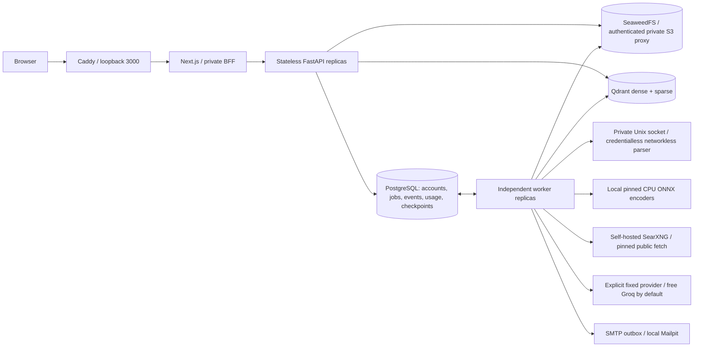

# Architecture and engineering decisions

## Consistency boundaries

The browser communicates through a same-origin Next.js BFF. It forwards only versioned API routes and whitelisted headers. Caddy overwrites the client-address header; the BFF adds a private server-side hop secret, which the API verifies before trusting that address. Other Docker services have no published ports. The default gateway and Mailpit ports bind only to loopback.

PostgreSQL owns application truth. A research run, request-payload digest, initial event and queue job commit in one transaction. An idempotency replay returns the original run; reusing its key with a different payload returns 409. The global admission row is acquired before workspace locks, then both shared and workspace pending limits are checked. Rate limiting inside admission uses this same transaction, avoiding a second-connection deadlock under saturation. Limits apply to accepted new work; compensating cleanup jobs can still be enqueued when user admission is full.

Workers choose one eligible head job per workspace, compare weighted virtual finish times, and claim with `FOR UPDATE SKIP LOCKED`. A shared scheduler row serializes global capacity and virtual-clock updates. One worker executes one job at a time. A 90-second lease is renewed every 30 seconds. Publication and checkpoint writes lock and verify the job's random fencing token and unexpired lease. Old workers may finish an external operation but cannot commit stale application results. Delivery remains at-least-once; arbitrary external calls are not claimed to be exactly-once.

Ingestion stores the original object first, creates an immutable version, parses it through a private Unix socket in a separate credentialless, networkless container and bounded child process, and upserts deterministic passage IDs into Qdrant. Only after successful indexing does a fenced SQL transaction mark the version ready and supersede the previous ready version. SQL eligibility is checked again around retrieval, so Qdrant's temporary stale points cannot authorize access. Older versions finishing late never supersede a newer ready version. Deleted sources are excluded immediately; asynchronous cleanup removes vectors, passages, original bytes and affected historical checkpoint snapshots. Object creation and SQL are not a distributed transaction: a hard crash between them can leave an orphan object; the operator reconciliation command lists and optionally removes unreferenced objects older than 24 hours for one explicit workspace. Normal metadata admission is locked during apply; direct operator restores and external S3 writers must be coordinated.

Research is a bounded LangGraph sequence: plan → retrieve → tools → answer → validate. Checkpoints use PostgreSQL and synchronous durability. Retries resume completed graph stages. A crashed in-flight generation request has ambiguous billing; its reserved upper bound is charged conservatively rather than silently refunded. Cancellation is cooperative between stages and checked again at publication. It cannot revoke an already accepted external request.

## Retrieval decision

Dense embeddings use `all-MiniLM-L6-v2`, sparse vectors use English BM25 with hashed term IDs and Qdrant IDF, fusion uses reciprocal ranks, and reranking uses a MiniLM MS MARCO cross-encoder. Model repository revisions and every downloaded file hash are recorded in `/models/manifest.json`. Startup validates the local cache before contacting the model hub. Encoders run through ONNX Runtime with bounded batches and CPU threads. The original FastEmbed wrapper was replaced with direct ONNX implementations after a transitive dependency security finding; a seven-input compatibility probe produced identical dense values, BM25 vectors and reranker scores for the same weights. That probe is a compatibility sample, not a proof for all possible inputs.

Qdrant stores workspace and document IDs as filterable payloads. Retrieval applies workspace and ready-version filters and preserves title, original URL, page/section, content hash, score and timing. Dense/BM25/hybrid/reranked modes use the same corpus. Mechanical citation checks ensure referenced IDs exist; they cannot establish factual entailment. Invalid generated references trigger a labeled extractive fallback, with both rejected and final citation diagnostics retained.

## Capacity and cost decisions

Quotas and fair scheduling solve different problems. Workspace quotas bound consumption; weighted dispatch prevents one eligible backlog monopolizing future slots. Weights 1/2/4 are operator provisioned. Request cost estimates differ by job kind. Dispatch is non-preemptive and does not guarantee weighted CPU seconds or a latency SLA. A single scheduler lock is intentionally simple and is an eventual throughput bottleneck; partitioning or dedicated service classes becomes appropriate after measuring lock contention and queue age.

Both deployment and tenant daily ledgers reserve 17,000 tokens before each model call, covering at most 14,000 UTF-8 input bytes, 12 messages and 2,000 output tokens. Known usage settles both ledgers. Calls are bounded to three per run; tools and wall-clock execution are also bounded. Deployment/storage/queue/concurrency caps prevent the sum of advertised account limits from becoming an unbounded infrastructure promise. Owner-configured paid providers never activate automatically.

## Deployment boundaries

The local stack has one PostgreSQL, one vector service and one object store. Independently adding API/worker replicas demonstrates stateless scale-out, not storage high availability. Production options are PostgreSQL replication/PITR and a pooler, a replicated Qdrant cluster, supported S3 storage, private service networking and TLS, and worker autoscaling on oldest eligible queue age. Capacity must remain bounded by downstream database, model and storage limits. Multi-region active-active coordination and real payment processing are design options, not implemented claims.

Migrations are versioned Alembic revisions. Only initialization receives migration credentials; runtime API/workers use a non-superuser role with table DML privileges and cannot create schemas or roles. Secrets are explicitly whitelisted into backend environments. Source parsers have OS resource limits and minimal environment credentials; this is resource isolation, not a complete sandbox against native parser compromise.
