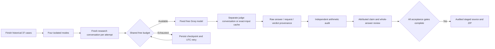

# Isolated live evaluation protocol

The original `live-ragas.json` campaign is retained and completed without replacing recorded scores. It historically shared a conversation between cases and judge RPCs, and some early scores lack original RPC identifiers. It is historical evidence, not the primary four-mode comparison.

The new `isolated-v2` protocol evaluates the same first 37 frozen, relevance-labeled held-out cases independently in dense, BM25, hybrid and hybrid-reranked modes: 148 case/mode pairs. No test labels, questions, prompts or low scores are adjusted to improve results. Corpus/model hashes, scorer lockfiles and actual versions, capability-removal patches, execution limits and implementation hashes bind resumption to one protocol. Changing them requires an explicitly reviewed new protocol version.

Each generation attempt receives a new research conversation. A crash between SQL creation and the JSON receipt cannot cause another attempt to reuse its history. A retained pending run resumes its own durable work. The graph rejects isolated runs with prior completed conversation history and records the actual history IDs; primary audits require an empty list. Judge requests have separate conversations. Identical model/message/configuration requests may reuse earlier marked judge RPCs in the fixed synthetic workspace; their actual origin conversation and expected request hash are exported. Such origins cannot overlap isolated research conversations.

Context precision/recall use the first five retrieved passages; faithfulness uses the exact text passages supplied to answer generation. Model-generated, local insufficient-evidence, citation-fallback and deletion-fallback answers are distinguished. Arithmetic correctness does not establish that a model's relevance/statement judgments are correct. Complete-answer review separately addresses claims omitted by the model's decomposition.

## Commands

```powershell
# Complete the legacy campaign, then all isolated modes, retaining quota checkpoints:
python scripts/manage.py benchmark --live --until-complete

# Explicit foreground selection (fails with a retained incomplete report at a quota):
python scripts/manage.py benchmark --live --campaign isolated-v2 --modes dense

# Refuses a final release until measurements, reviews and current gates are complete:
python scripts/manage.py finalize

# Optional honestly labeled intermediate archive; cannot authorize publication:
python scripts/manage.py finalize --checkpoint
```

The normal command runs with no paid provider and no automatic fallback. Free daily quotas can require multiple days; the host and Docker must be available for progress. A quota wait is unfinished work. Per-mode reports, research exports, verdict exports and the independent arithmetic audit remain in `evaluation/results`.

## Review and release

`isolated-factual-support-review.csv` records the model's per-claim judgment separately from an attributed assistant decision and note. `isolated-answer-review.csv` requires review of each entire answer, including unlisted claims. Exports preserve actual decisions only when the answer/context bindings match and never auto-fill assistant or human verdicts. Human validation remains explicitly separate.

The API exposes authenticated campaign summaries/details at `/v1/evaluations/campaigns`. It permits fixed campaign identifiers and typed public-sample fields only. The UI shows quota/partial/error/empty states, scores, recorded text and request provenance; it does not execute source HTML.

Finalization checks executed JUnit cases against `evaluation/requirements.json`, current source-bound functional/security/rehearsal/scaling evidence, complete 37/148 campaigns, exact artifact hashes, protocol source compatibility and complete review coverage. The final ZIP is the audited staged Git tree. Publication repeats the same candidate/tree/credential checks and refuses incomplete acceptance, owner mismatches, collisions and force pushes. No automatic commit or publication occurs during finalization.




Undefined/nonfinite or out-of-range Ragas results are not published as numeric scores. Within the isolated campaign, the last such structured judge RPC is listed in `rejected_judge_runs` and bypassed on resume; finite low and zero scores remain unchanged. This is a declared bounded retry policy, not a claim that every undefined decomposition is invalid JSON. Rejected raw RPCs remain in PostgreSQL; successful-metric exports do not themselves establish their raw contents. Count and inspect these attempts separately when interpreting completed scores.
